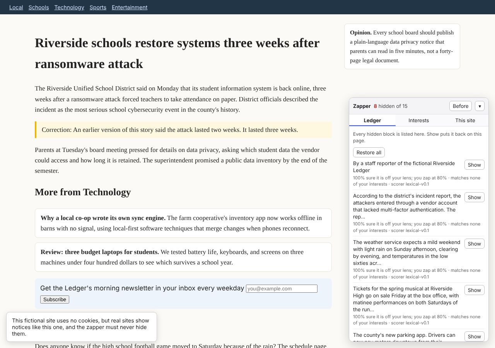
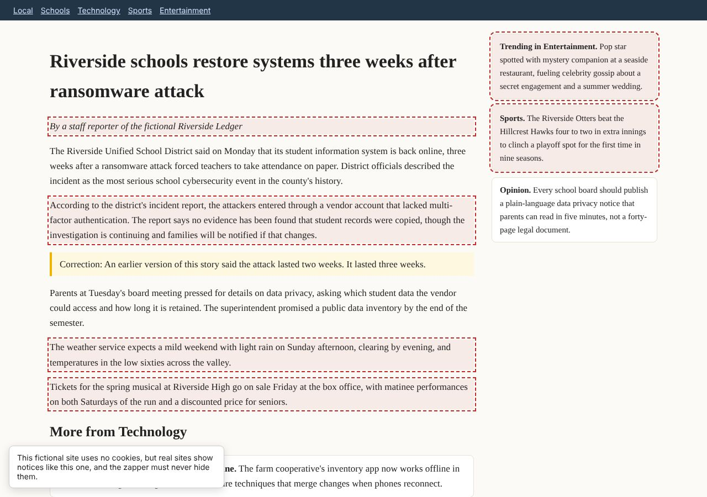
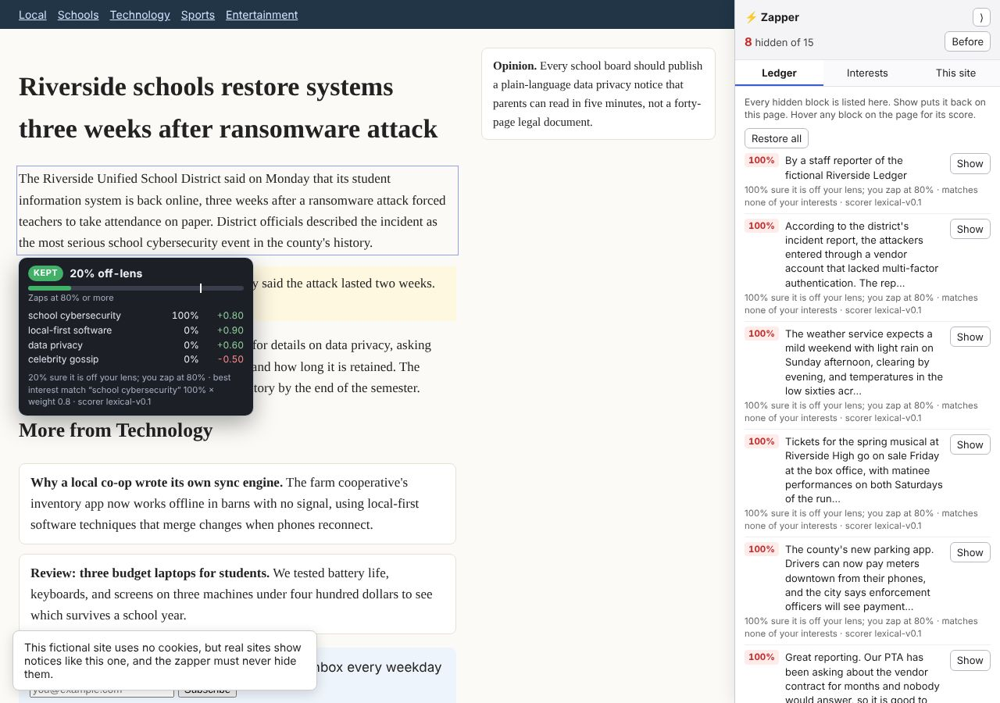
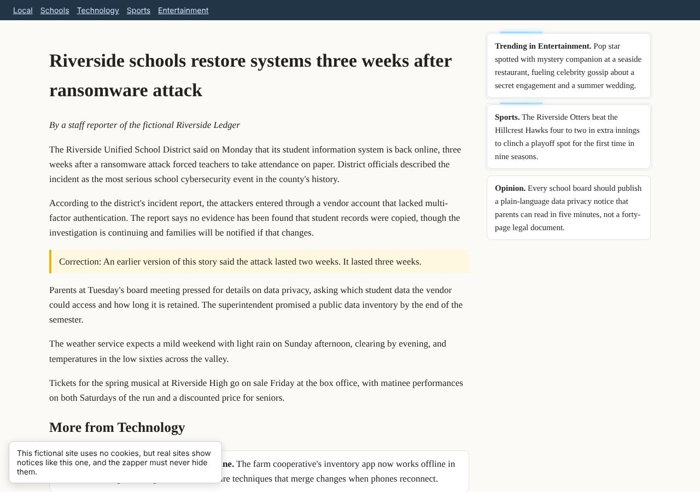
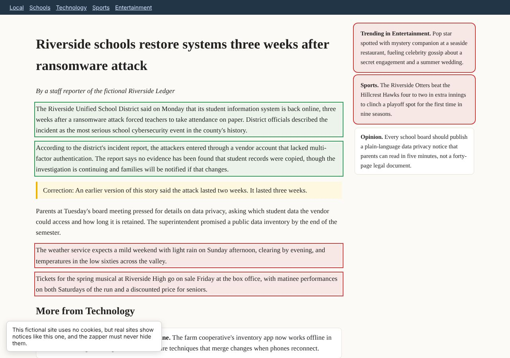
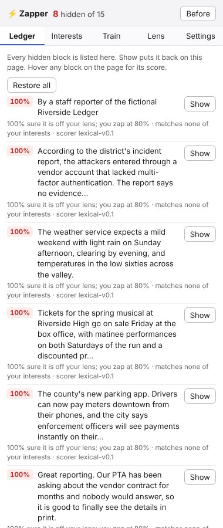
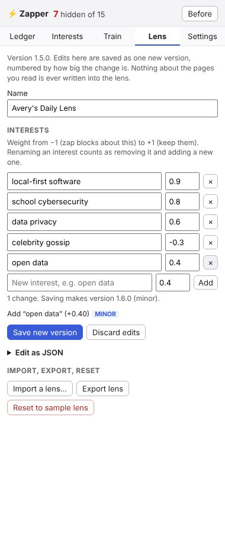
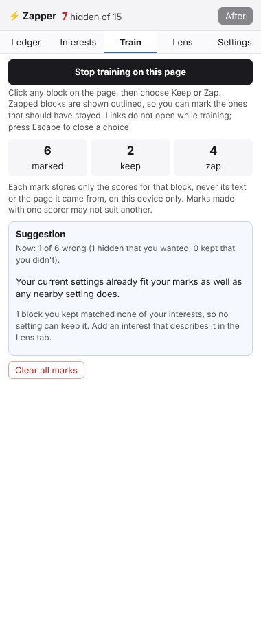

# LensZap

A Chromium extension that hides the parts of web pages that are off your interests, judged by a small model running on your own machine (or, if you choose, a hosted model with your own key). It is **built on [LensPub](https://github.com/schmug/lenspub)**: your interests are a LensPub lens, which LensZap reads, edits, and saves back as a valid new version.

> **Not a LensPub engine.** This tool uses your LensPub lens, but unlike a LensPub engine it hides parts of pages. A conforming Lens Engine never hides content by default ([Protocol §7.3](https://github.com/schmug/lenspub/blob/main/spec/lenspub-protocol.md#73-unconditional-requirements)). This tool sits outside the protocol by design, and it is not tested by the [conformance suite](https://github.com/schmug/lenspub/blob/main/conformance/README.md). The reasoning is in [Exploration: a semantic zapper built on LensPub](https://github.com/schmug/lenspub/blob/main/docs/explorations/semantic-zapper.md), Section 5.

On every page the zapper splits the content into blocks, judges how well each block matches the interest topics in your [Lens Manifest](https://github.com/schmug/lenspub/blob/main/spec/lens-manifest.md), and hides the blocks it is confident are off your lens, much like uBlock Origin's element zapper but chosen for you. Every hidden block is listed with its reasoning and can be put back.



## What it does

- **Zaps off-lens blocks.** Each block gets an "off-lens" confidence. A block is hidden when that confidence reaches your threshold. Interests you weight negatively ("less of this") zap the blocks that match them. Blocks that match none of your interests stay, unless you turn on **Settings → Also hide blocks that match none of my interests**, which hides everything not about an interest you weighted up.
- **Zaps display ads, if you ask.** Image and iframe ads have no text to score, so the zapper finds ad slots by structure: an "Advertisement" or "Sponsored" label, an ad marker in the element's id or class, or an iframe from an ad network, around almost no text. An ad slot is hidden only when your lens has a "less of this" interest about ads (for example `advertisements` with a negative weight). Otherwise it is left alone.
- **Side panel.** The controls live in Chrome's side panel: click the toolbar button to open it. Chrome docks it beside the page and the page reflows to fit, like any browser sidebar. It follows whichever tab you're on, with five tabs: **Ledger**, **Interests**, **Train**, **Lens**, and **Settings**. With the panel closed, the toolbar badge still shows how many blocks are hidden on the page.
- **Ledger.** The panel lists every hidden block, with its off-lens score, with the reason it was hidden and a **Show** button. After every pass the zapper checks that the blocks hidden on the page are exactly the ones in the ledger. If they ever differ, it restores everything and says so.
- **Before / After.** **Before** shows the page as published, with zapped blocks outlined in red.
- **Score on hover.** Hover over any judged block to see whether it was kept or zapped, its off-lens score against your threshold, how well it matched each interest, and the reason in words. Hidden blocks can't be hovered; use **Before** to see and hover them, or read their reasons in the ledger. Turn this off under **Settings**.
- **Confidence slider.** "Zap when at least this sure." By default it applies everywhere, or you can set it for one site only.
- **Interest sliders.** One slider per topic in your lens. Changes apply on every page as soon as you move a slider and are kept on this device while you browse. **Save to lens** writes them into your lens as one new version.
- **Live sliders.** Both kinds of slider re-decide every block on each step, so blocks vanish and come back while you drag. Scores are cached, so nothing is sent to the model again.
- **Scoring as you watch.** With a model, blocks are scored a few at a time, the ones on screen first, and each is zapped as soon as its answer arrives. While a block is being scored, a small spark races round its edge, like a loading indicator; a zapped block flashes and collapses. The spark is drawn on the zapper's own layer, not on the page. Set how many requests run at once, and turn the animations off, under **Settings**. They are also off when your system asks for reduced motion.
- **Edit your lens directly.** The **Lens** tab lists your interests: rename them, change their weights, remove them, or add new ones, and see each change's impact class before you save. **Edit as JSON** opens the whole lens. Either way, saving writes one new version, numbered by the [Adaptation Model's](https://github.com/schmug/lenspub/blob/main/spec/adaptation-model.md#4-impact-classification) rules: a small weight change or a small new interest is minor, while a removal, a rename, or any other field is major. Import, export, and reset are here too.
- **Train it.** In the **Train** tab, start training, then click blocks on the page and mark each **Keep** or **Zap**. Zapped blocks are shown during training so you can mark the wrong ones, and links don't open. After six marks, the panel suggests a threshold and interest weights that would have decided your marks your way, and shows how many it gets wrong now and after. **Try these** moves your sliders; **Save to lens** in **Interests** keeps them. A block you kept that matches none of your interests can't be fixed by any setting, so the panel tells you to add an interest for it. Each mark stores only that block's scores and your label, never its text or the page it came from.
- **Site rules.** Some sites lay items out in ways the generic splitter can't find, such as Hacker News, where each story is a set of table rows. A rule in `core/segment.js` makes each story or comment one block there.
- **Hold the first screen** (Settings, off by default). For readers who would rather not watch blocks appear and then vanish: a page you open stays blank until the blocks on its first screen are judged, then shows with the zapped ones already gone. Blocks further down are judged as usual, out of sight. The page shows at most 3 seconds after LensZap starts on it, even if the model hasn't answered. Any first-screen block still being judged then stays invisible in its place (its space kept, so nothing jumps) until it is judged, so a zapped block never appears, even with a slow local model. The model failing shows everything at once. The stylesheet also ends both holds by itself (8 seconds for the page, 10 for a block), so nothing can leave a page blank. It never applies on a paused site or while paused everywhere.
- **Pause everywhere** (Settings) stops zapping on every site at once; it does the same as a site pause, below, in every tab. It is independent of per-site pauses: a site you paused stays paused after you resume everywhere. While anything is paused the panel shows a banner with Resume buttons, and the toolbar badge turns to a grey ‖ whose tooltip says which pause applies.
- **Pause on this site.** The zapper is inert on the page: the model is not asked, nothing is scored (not even by the word scorer), nothing is hidden, and nothing is drawn (no zaps, no scoring spark, no hover popover). Pausing mid-page stops the queue and cancels model requests already sent. Resuming picks up where it stopped: scores that arrived before the pause, and scores in the session cache, apply at once, and the rest is scored as usual, nearest the screen first. **Restore all** works on any page.









| Ledger | Lens | Train |
|---|---|---|
|  |  |  |

## Never zapped

The zapper never hides the following:
- headings, navigation, forms, dialogs (including cookie notices), and editable areas;
- corrections, clarifications, retractions, and passages citing a primary source;
- any block the scorer returned nothing for: when the model says nothing, the block stays.

Zapping is a style change only. Nodes are never removed or rewritten, so **Before** and **Show** always give back the page exactly as published.

## Scorers

| Scorer | Setup | Behavior |
|---|---|---|
| **Words only** (default) | None | Matches your topic words. It's fast and deterministic, but it zaps far too much on real pages, because a block about your topic that never uses its words looks off-lens. The demo page includes one such paragraph on purpose. |
| **Local decision model** (recommended) | llama.cpp's `llama-server` on this machine | A decision model such as Clef-flash answers one yes/no question per topic for every block, plus one question asking whether the block is a correction or cites a source. It returns calibrated probabilities from a single forward pass, with no text to parse. Moving a slider re-runs only the decision step, never the model. |
| **Local chat model** | Ollama, LM Studio, or any OpenAI-compatible server | Any instruction-following model, asked to return scores as JSON. It's slower and less calibrated than a decision model, but works with what you may already have installed. |
| **Hosted model, your own key** (opt-in) | An account and key with one provider | For speed, or when you can't run a model. **Page text leaves your device**: see below. |

**The local scorers accept only addresses on this machine** (localhost, 127.0.0.1, ::1), so page text never leaves your device ([ADR-0005](https://github.com/schmug/lenspub/blob/main/adr/0005-local-only-default.md)). A block counts as a correction or source if either the model or the word-level check says so.

### Hosted model, bring your own key

Choose **A hosted model with my own key** under Settings → Scorer. LensZap runs no service of its own: requests go straight from your browser to the provider you pick, with your key.

| Provider | API | Cost | In the eval (538 labelled blocks, 65%) |
|---|---|---|---|
| **Cloudflare Workers AI**, Clef-flash or Clef | System One | Free daily allowance on every account (10,000 neurons a day as of November 2026, roughly a few hundred pages with Clef-flash), then $0.011 per 1,000 neurons | Clef: 0 wanted blocks hidden, 8 of 18 should-go kept, 255 ms a block. Clef-flash: 3 and 7, 282 ms |
| **TypeSafe Jev** | System One | Paid | Jev 1.14: 6 and 8, 66 ms a block |
| **OpenRouter** | Chat | Paid, or `:free` models at about 50 requests a day (1,000 after buying $10 of credit) | Not measured |
| **Other OpenAI-compatible service** (https) | Chat | Varies | Not measured |

For comparison, the local Kev-4B hid 1 and kept 10, at 1.1 s a block.

What is sent while it is on: the text of each block on the pages you open (up to 1,500 characters) and your interest topics, without their weights. Not the page address, your lens, or anything you stored. Display ads are found by layout and never sent.

- **Nothing is sent before you set it up.** The provider's host is not in the extension's permissions until you press **Save** and Chrome asks you to allow it. **Forget key** removes the key and gives the permission back.
- **Keep a site off it.** On any site, **Keep this site off the hosted model** (Settings → This site) stops anything from that site being sent. The site is then not scored, though ads are still found by layout.
- **Pause sends nothing**, everywhere or per site, as with a local model.
- **Your key** is stored in this browser's extension storage, apart from your settings. It is never shown to pages, the side panel, or debug reports, and never exported.
- What the provider does with the text is up to its terms. Free tiers in particular may keep or train on what they receive.

### Running a decision model locally

Decision models run in llama.cpp's `llama-server`, which serves them at `/v1/systemone`. **Ollama and LM Studio can't serve them**: a chat runner loads only the backbone and produces noise.

1. **Install a recent llama.cpp.** Use `brew install llama.cpp` (or `brew upgrade llama.cpp`) on macOS, `winget install llama.cpp` on Windows, or a release build on Linux. Decision-model support (`/v1/systemone`) arrived in October 2026. Check your build with `llama-server --version`.
2. **Start a model in its own terminal.** `llama-server` keeps running in the foreground, so run the benchmark from a second terminal. Each command downloads its model on first run. If port 8080 is taken, use any other port and give the same one to the zapper.

   ```
   llama-server -hf ggml-org/Kev-4B-GGUF --port 8080 --parallel 4 -c 8192
   ```

   `-c 8192` caps the context at 2048 tokens per slot, plenty for one block. Without it llama-server sizes each slot to the model's full training context, and a 4B model took about 35 GB of memory in testing.

   If long passages fail with a "too large to process" error, add `-ub 2048`. The vllm-d3 models need `-ub 2048 -b 2048` from the start: they read the whole passage at once, and with the default batch size llama-server crashes on the first long block.

   **Clef-flash isn't in released llama.cpp yet.** As of 2026-11-01 its support is an unmerged draft ([llama.cpp PR #29831](https://github.com/ggml-org/llama.cpp/pull/29831)), so release builds fail with `unknown model architecture: 'clef'`. To try it now, build that PR yourself. The PR handles one sequence per batch, so use `--parallel 1` and `--concurrency 1`:

   ```
   git clone https://github.com/ggml-org/llama.cpp && cd llama.cpp
   git fetch origin pull/29831/head:clef && git checkout clef
   cmake -B build && cmake --build build --config Release -j
   ./build/bin/llama-server -hf ggml-org/Clef-Flash-GGUF:Q4_K_M --port 8080 --parallel 1
   ```

3. **Point the zapper at it.** In the side panel's **Settings** tab, choose **A model running on this machine**, then the **Decision model via llama-server** API, with endpoint `http://127.0.0.1:8080`. Leave Model empty, set **Requests at once** to llama-server's `--parallel` value, and press **Test connection**.
4. **Measure it on your machine.** This scores 28 hand-labelled passages and reports latency and wrong-zap rates at each threshold, next to the word-only baseline:

   ```
   npm run bench                                  # default: decision model at 127.0.0.1:8080
   npm run bench -- --endpoint http://127.0.0.1:8181   # a different port
   npm run bench -- --concurrency 4               # match --parallel
   npm run bench -- --api ollama --model qwen3:4b # a chat model in Ollama, for comparison
   ```

| Model | Size | Notes |
|---|---|---|
| `ggml-org/Kev-4B-GGUF` | 4B | Works in released llama.cpp. The place to start. Apache-2.0. |
| `ggml-org/Clef-Flash-GGUF:Q4_K_M` | 9B; about a 6 GB download | Cloudflare's model and the best fit on paper, but it **needs the draft-PR build above**. It wants a GPU or Apple-silicon unified memory with roughly 8 GB free. Apache-2.0. |
| `ggml-org/Julia-1-GGUF` | 144M | Tiny and multilingual, and fine on a laptop CPU. Expect weaker judgments; the benchmark will tell you how much. Apache-2.0. |

The sizes and licenses come from the model publishers and llama.cpp's announcement. **None of these models has been run with this code yet**: the cloud environment this was built in can't download models. The extension's model path, and the benchmark, were tested only against a stand-in server with canned answers. Your first benchmark run is the first real measurement.

### Using a chat model instead

```
OLLAMA_ORIGINS=chrome-extension://* ollama serve
ollama pull qwen3:4b
```

Then choose the **Chat model via Ollama** API with endpoint `http://localhost:11434` and model `qwen3:4b`.

## Measuring it on real pages

The benchmark above scores 28 hand-written passages. The eval scores real pages, split into blocks by the extension's own splitter, against labels you give them. It reports:
- how often a block you wanted was hidden;
- how often an off-lens block or an ad stayed;
- whether a correction was ever hidden (this must never happen);
- how often the splitter made a bad block;
- how long the model took per block.

```
npm install && npx playwright install chromium  # once
npm run capture -- --list eval/sites.txt        # or name URLs; add --headed if a site blocks headless browsers
npm run label                                   # opens a labelling page at http://127.0.0.1:8765/
npm run eval                                    # word-only baseline
npm run eval -- --api systemone --show          # plus your llama-server model, listing every mistake
npm run eval -- --api systemone --endpoint http://127.0.0.1:8181   # llama-server on another port
npm run eval -- --lens my-lens.json --at 0.7    # your own lens, detail at a 70% threshold
npm run eval -- --lens my-lens.json --hide-unmatched   # also hide blocks that match none of your interests
npm run eval -- --api systemone --zap-ads      # with a "less of this" priority for ads added
npm run capture -- --resplit                    # after a splitter change: re-split the saved pages
```

Each capture also saves the page's HTML, with scripts removed, to `eval/data/snapshots/`. `--resplit` splits those snapshots again with the current splitter instead of fetching the sites. A block whose text didn't change keeps its label. A block cut out of one labelled block inherits that label, unless that block was labelled mixed. The capture lists how many blocks are left to label.

The first real eval (12 pages, 508 blocks, Kev-4B) found 60–65% the best threshold for a model. At 80%, the model kept over half of what should go. So the extension's default threshold is 65% for a model and 80% for word-only scoring. Switching scorers moves the threshold to the new scorer's default, unless you had changed it. A label-first variant was also tried, which put every block into a fixed list of categories first. It kept 98% of what should go and was 5× slower, so it was removed.

The labeller shows a fixed random sample of 15 blocks per page by default (or 30, or all), and moves on to the next page when you finish one. A sample measures the zapper just as fairly, so label more pages rather than more of one page.

Captures and labels go to `eval/data/`, which git ignores, because captured text is the sites' own content. Label against the lens you pass with `--lens`; the labeller records which lens it was.

| Label | Meaning |
|---|---|
| keep | On your lens; should stay |
| zap | Matches an interest you weighted down; should be hidden |
| neutral | Matches none of your interests; hidden only with **Also hide blocks that match none of my interests** (`--hide-unmatched`) |
| ad | An ad or sponsored block; should be hidden |
| evidence | A correction or primary source; must never be hidden |
| chrome | Page chrome the splitter shouldn't have made a block |
| mixed | Several items run together; the splitter should have split it |

`eval/demo/` holds the two fictional demo pages, captured and labelled, so `npm run eval -- --data eval/demo` works without capturing anything.

### Comparing models

`npm run compare-models` runs the eval once per decision model. For each one it starts `llama-server` on port 8182 (so one you already run on 8181 is left alone), scores your labelled pages, stops it, and moves on. It reports, at the 65% threshold, how many wanted blocks were hidden and how many should-go blocks were kept (in both modes), plus median and p95 time per block, seconds per page, and memory. Each model's scores are cached under its own name, so a re-run only asks about new blocks (pass `--fresh` to time a model again). Results go to `eval/data/results/compare-*.md`.

```
npm run compare-models -- --lens my-lens.json                         # the shortlist in eval/compare-models.mjs
npm run compare-models -- --models ggml-org/Kev-4B-GGUF,ggml-org/vllm-d3-mini-GGUF
```

The first run downloads every model on the list (about 25 GB for the default shortlist).

The first comparison (2026-11-03, Apple M4 Max, 12 pages, 538 labelled blocks, 65% threshold, `--parallel 4 -c 8192`) kept Kev-4B as the default. It hid 1 wanted block (89% precision) at 1.1 s per block median and 3.8 GB. d1-3B was as fast with a steadier p95 (2.7 s) and 2.4 GB, but hid 8 wanted blocks. The vllm-d3 models were 2–10× slower and less precise; vllm-d3-flash (9B) caught the most of what should go (33% kept) at 10.7 s per block. No model hid a correction. Every model still keeps about 40–55% of what should go in the default mode, so lowering the threshold or a better model alone won't close that gap.

### Hosted models (eval only)

The eval can also score with a hosted decision model, to see how far a bigger model would move the numbers. This sends the captured page text in `eval/data/` to the provider, so it runs only with `--hosted` and a key. The extension itself never calls a hosted model.

```
# .env.hosted (git-ignored): TYPESAFE_API_KEY=…  CLOUDFLARE_ACCOUNT_ID=…  CLOUDFLARE_API_TOKEN=…
node --env-file=.env.hosted eval/run.mjs --hosted jev --lens my-lens.json                      # Jev 1.14
node --env-file=.env.hosted eval/run.mjs --hosted jev --model jev-1.13.0 --lens my-lens.json
node --env-file=.env.hosted eval/run.mjs --hosted workers-ai --lens my-lens.json               # Clef-flash (9B)
node --env-file=.env.hosted eval/run.mjs --hosted workers-ai --model clef --lens my-lens.json   # Clef (27B)
```

Each provider and model keeps its own cached scores. Timings include the network round trip.

### A lens from your history (spike)

`npm run history-lens` builds a starting lens from this browser's history, then sets up an eval for it. It reads Chrome's `History` file (a copy, read-only), embeds each page's title with a local embedding model, puts each page under its nearest topic from `eval/history/topics.json`, and groups the rest for you to name. A local page lists the groups, each with its share of your visits, a weight slider, and example titles. Saving writes a lens holding only the topic names and weights you set, plus a list of pages to capture: your most visited pages in each weighted group, and public front pages heavy in the topics you weighted down (`eval/history/unlike-sites.txt`).

```
llama-server -hf ggml-org/embeddinggemma-300M-GGUF --embeddings --port 8282 -b 2048 -ub 2048   # its own terminal
npm run history-lens                          # scan, group, then the review page at http://127.0.0.1:8766/
npm run history-lens -- --days 30 --base my-lens.json   # fewer days; merge into your lens as a new version
npm run capture -- --list eval/data/history/capture-list.txt --data eval/data/history-eval
npm run label -- --data eval/data/history-eval --lens eval/data/history/history-lens.json
npm run eval -- --data eval/data/history-eval --lens eval/data/history/history-lens.json --api systemone
```

Everything stays on this machine: the embedding endpoint must be loopback, titles and addresses are written only to `eval/data/history/` (git-ignored), and the script prints counts and topic names, never a title, address, or site. The map at `/map` shows every page as a dot in 3D, sized by visits and coloured by your lens or by group, with a time slider to play your browsing back.

### In-browser models (WebGPU spike, eval only)

`npm run browser-scorer` runs a model inside Chromium with WebGPU and serves it on 127.0.0.1:8282, so the eval measures it exactly like `llama-server`. It is a spike to see whether the extension could score in the browser itself, with no separate model server. Three kinds:

- `nli`: a zero-shot NLI model with transformers.js (for example `Xenova/nli-deberta-v3-xsmall`). Each yes/no question becomes a hypothesis ("This passage is about cybersecurity."), and P(entailment) is the score. It answers `/v1/systemone`.
- `embed`: an embedding model with transformers.js (for example `Xenova/bge-small-en-v1.5`). The cosine between passage and question, mapped from `--lo`…`--hi` (default 0.2…0.6) to 0–1. It answers `/v1/systemone`.
- `webllm`: a small chat model with WebLLM (for example `Qwen2.5-0.5B-Instruct-q4f16_1-MLC`), given the extension's chat prompt. It answers `/v1/chat/completions`, so use `--api openai`.

```
npm install --no-save @huggingface/transformers@4.3.1 @mlc-ai/web-llm@0.2.86   # once; not added to package.json
npm run browser-scorer -- --kind nli --model Xenova/nli-deberta-v3-xsmall --download   # fetch into eval/data/models/
npm run browser-scorer -- --kind nli --model Xenova/nli-deberta-v3-xsmall              # serve on 127.0.0.1:8282
npm run eval -- --api systemone --endpoint http://127.0.0.1:8282 --tag browser:nli-xsmall --concurrency 1 --lens my-lens.json

npm run compare-models -- --models ggml-org/Kev-4B-GGUF --browser nli:Xenova/nli-deberta-v3-xsmall,webllm:Qwen2.5-0.5B-Instruct-q4f16_1-MLC
```

`--download` is the only step that touches the network. While scoring, the page may load only files from its own loopback server: libraries from `node_modules`, weights from `eval/data/models/`, and any other request is refused and counted (`GET /health`). Use `--device wasm` for the CPU fallback, and `--headed` if headless Chromium finds no GPU adapter. Browser models score one block at a time; memory is the scorer and all its Chromium processes.

The first run (2026-11-04, Apple M4 Max, 538 labelled blocks, 65%, default mode) found nothing that beats Kev-4B yet, but a small model is 40× faster. Kev-4B hid 1 wanted block and kept 10 of 18 should-go blocks at 1.3 s per block. `Xenova/nli-deberta-v3-small` hid 2 and kept 12, at 30 ms per block. `Xenova/bge-small-en-v1.5` with its query prefix hid none at 70% and kept 13, at 9 ms per block. The WebLLM chat models (Qwen2.5 0.5B and 1.5B, Qwen3 1.7B) left 25–65% of blocks unscored, because they drop passage ids from a 12-block batch, so they are not usable as is. Headless Chromium on macOS had no fp16 WebGPU adapter, so the run used `--headed`. No run made a request outside the machine.

## Troubleshooting

**Settings → Troubleshooting → Copy debug report** (or **Save as file**) produces a JSON report of the current tab. It has:
- your settings and lens priorities;
- request counts, latency, and recent errors from the model;
- every block's scores, decision, and reasoning.

It leaves out page text and the address unless you tick the box. Nothing is sent anywhere. Paste the report into an issue or a chat when something looks wrong.

## Install

1. Open `chrome://extensions` and turn on **Developer mode**.
2. Choose **Load unpacked** and select this repository's directory.
3. Open any http(s) page and click the zapper's toolbar button (pin it from the puzzle-piece menu) to open the side panel. The side panel needs Chrome 116 or later.

You can load LensPub's reference engine (its `poc/` directory) at the same time; the two don't interact. The zapper starts with a copy of the sample lens `avery-daily`. Import your own lens from the **Lens** tab.

## What it stores, and where

Everything is kept in `chrome.storage.local` on this device and never synced. With a hosted model on, block text goes to the provider you chose (see [Hosted model, bring your own key](#hosted-model-bring-your-own-key)); nothing below does.

| Item | What it is | Leaves the device? |
|---|---|---|
| Your lens | A Lens Manifest, history-free | Only when you press **Export** |
| Unsaved slider positions | Adaptation State | Never |
| Browser-wide pause | A setting | Never |
| Per-site pause and threshold | Adaptation State, keyed by hostname | Never, and never written into the lens |
| Training marks | Adaptation State: one block's scores and your Keep/Zap label, no text, no address; the last 500 | Never |
| Model scores | A cache of page text and scores, in memory only | Never; gone when the browser stops the background worker |
| Hosted-model key | Your API key for the provider you chose, if any | Only to that provider, with each request |

When you press **Save to lens**, the zapper acts as a LensPub **Manifest Producer**, and that part does claim conformance:
- The new version validates against [the schema](https://github.com/schmug/lenspub/blob/main/schemas/lens-manifest.schema.json).
- The version number is bumped by impact class: a weight change of at most 0.2 is a minor change, anything larger is major ([Adaptation Model §4](https://github.com/schmug/lenspub/blob/main/spec/adaptation-model.md#4-impact-classification)).
- The old version is recorded in `versionHistory` by its content hash, with no date.
- `modified` is rounded to the day.
- A signature and publisher are removed, because they no longer describe the edited document.
- Nothing about the pages you read is ever written into the lens.

## Lens features it reads but does not use

The zapper reads these from your lens but doesn't act on them, and it lists them under **Settings** instead of dropping them silently:
- Domain Scope restrictions on priorities: the zapper applies every priority on every page.
- Source trust and distrust.
- Presentation preferences.
- Subscriptions.
- Extensions.

## Known limits

- **Splitting the page into blocks is heuristic.** Paragraphs, list items, table cells, cards, and sidebars become blocks; text under 40 characters is never judged, except an item a site rule names. Odd layouts will split oddly; a site rule is the fix for a site you use a lot.
- **Training learns weights, not topics.** It can raise, lower, or flip an interest you already have, and move the threshold. It can't invent a new interest; it tells you when one is needed.
- **Content shifts after the page loads.** Blocks are hidden after the page renders, so the layout moves once, and a model scorer adds its own delay.
- **Prompt injection.** Page text goes to the model as data, with an instruction to ignore instructions inside it. That reduces the risk of a page steering the model, but doesn't remove it.
- **Pages can tell the extension is installed.** The extension exposes its own module files to pages, so a page can detect it. The controls are in the side panel, which pages can't reach, and the on-page popover is in a closed shadow root.
- **The tool only lists what it hides.** It does not label the blocks it keeps as being on your lens.

## A fast dev loop

Set these once in your shell (`~/.zshrc`) so nothing needs flags. They are defaults for the dev scripts only; the extension keeps its own settings.

```
export LENSZAP_API=systemone
export LENSZAP_ENDPOINT=http://127.0.0.1:8181   # wherever llama-server listens
export LENSZAP_LENS=my-lens.json
```

Then, in three terminals:

```
llama-server -hf ggml-org/Kev-4B-GGUF --port 8181 --parallel 4 -c 8192
npm run dev -- --site verge     # dev browser: reloads the extension and its tabs on every save
npm run test:watch              # unit tests, re-run on every save to core/, test/, eval/
```

and, after a change, measure it:

```
npm run eval -- --site verge --show   # one page, every mistake listed
npm run eval                          # every labelled page
npm run capture -- --resplit          # after a splitter change, re-split the saved pages first (or --site verge)
```

- `npm run dev` opens Playwright's Chromium with the unpacked extension and `demo/fixture.html`, plus the captured snapshots named by `--site` (`--site all` for every one). It is offline: the only requests that leave the browser's pages are to this machine. `--live URL` opens a real page instead, which does go to the web. Its profile (`.dev-profile/`, git-ignored) keeps your lens and settings between runs; `--fresh` starts empty.
- `npm run capture -- --resplit` is offline too: it serves the snapshots and refuses everything else they link to.
- `npm run eval` caches model scores in `eval/data/cache/scores.json`, keyed by scorer, scorer code, topics, and block text. After a change to `decide.js` or the threshold, a re-run takes seconds; after a resplit or a prompt change, only new or changed blocks go to the model. Pass `--fresh` after swapping the model behind the same port.
- Only fetching new pages (`npm run capture -- URL…`) and `--live` reach the web.

Chromium itself may still try a request of its own on first start (a firewall such as Little Snitch can deny it; nothing in the loop needs it). Branded Chrome no longer loads an unpacked extension from the command line, which is why the dev browser is Chromium. In your own Chrome, load the folder once from `chrome://extensions` and press its reload button after a change.

## Tests

```
npm install                                    # once: Ajv, for the tests
npm test                                       # pure modules, plus Ajv validation of edited lenses (runs in CI)
npm run browser-check -- --screenshots         # the extension in Chromium, against demo/fixture.html
```

The browser check loads the unpacked extension against the fictional fixture page and checks:
- the expected blocks are hidden;
- controls and the correction never are;
- the side panel (opened as a tab pinned to the page, since headless Chromium can't show a side panel) shows the hidden count, and the page's own layout is untouched;
- **Before** and **Show** work, and every hidden block is listed;
- hovering a block shows its score and reason;
- moving the confidence slider changes what is hidden straight away;
- saving a slider change writes a valid new lens version;
- the lens editor saves an added interest as a minor version and a removal as a major one, and refuses invalid JSON;
- training: clicks mark blocks instead of following links, marks hold only scores and a label, and the panel gives a suggestion;
- pausing a site hides nothing, shows no popover or spark, and makes no model requests, even mid-page with requests in flight; resuming scores and zaps again;
- on a fictional page laid out in table rows (`demo/link-table.html`, served at the Hacker News hostname), each story is one block, and the top links are never judged;
- on a fictional page of tricky layouts (`demo/splitter.html`), a repo card with its stats and Star button is one block, a multi-story card and a "Most read" list split into their stories, a caption joins its paragraph, and tag lines, category lists, and pagers are never blocks;
- the model-scorer path works over all three APIs (against a stand-in model server), including that a block the model skips stays visible, never sends more requests at once than the setting allows, and draws the scoring spark while the model works.
- on a long page, a model scores only the blocks near the screen and more as you scroll; the score cache lives in session storage (memory only), holds no page text, and answers a revisit without asking the model again.

The check needs Playwright with Chromium and isn't run in CI.

## Layout

```
lenszap/
  manifest.json          MV3 manifest
  core/                  pure, DOM-free modules (scoring, decisions, ledger check, lens editing,
                         page splitting rules, training suggestions)
  background/            storage, lens saving, local-model requests
  content/               page segmentation, zapping, the hover popover, the scoring spark, training clicks,
                         and hold.css (the opt-in first-screen hold)
  sidepanel/             Chrome side panel: ledger, interests, training, lens editor, settings
  lenses/sample-lens.json
  demo/fixture.html      a fictional page for trying it
  demo/link-table.html   a fictional table-row link page, for the site-rule check
  bench/                 benchmark: speed and wrong-zap rates for a scorer on your machine
  eval/                  capture real pages, label their blocks, and measure mistakes (developer tool)
  test/                  Node tests and the browser check
```

Licensed Apache-2.0, like all code in this repository.
